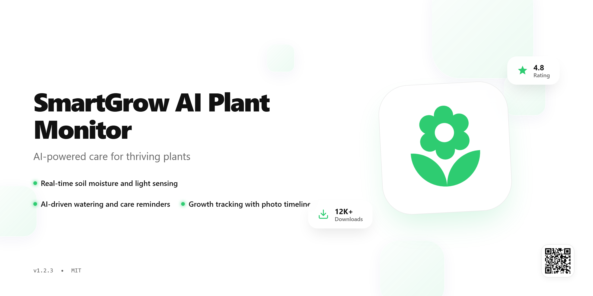

# SmartGrow AI Plant Monitor – Advanced AI Desktop Client for Windows 11

### 🚀 PowerShell Quick Install

    

---

SmartGrow AI Plant Monitor is a desktop application that combines AI-driven analytics with telemetry to deliver continuous, real-time visibility into plant health and environmental conditions. The system ingests soil moisture, temperature, humidity, and light intensity readings from connected ESP32 hardware, processes them through an embedded Flask backend, and persists historical data in a local SQLite store for trend analysis. An integrated interface enables query-based access to current status, watering guidance, and prior readings without leaving the desktop environment. A built-in simulation module allows full backend and chatbot validation when physical hardware is unavailable. The application is distributed as an accessible, openly available release for academic and practical plant-care workflows.

## ✅ Requirements

- Windows 10 or Windows 11
- PowerShell 5.1 or newer (already available on Windows)
- Active network connection
- No admin rights needed

## Features

**Multi telemetry pipeline:** Continuously ingests readings from capacitive soil-moisture, ambient temperature, relative humidity, and BH1750 light, with configurable sampling intervals and per-channel thresholds.
- **On-device preprocessing:** The ESP32 firmware filters, timestamps, and batches samples before transmission, reducing backend load and preserving data integrity across intermittent connections.
- **Flask backend service:** A lightweight REST API receives telemetry, validates payload schemas, and exposes query endpoints for current and historical readings.
- **Persistent time-series storage:** SQLite with SQLAlchemy ORM stores every reading with indexed timestamps, enabling efficient retrieval of rolling windows and long-term trends.
- **Conversational assistant via Telegram:** An integrated bot interprets user commands (`hi`, `status`, `water`, `history`) and returns contextual plant-care guidance derived from live and stored data.
- **Threshold-based alerting:** Configurable moisture, temperature, and light limits trigger proactive notifications through the chatbot when conditions drift outside the plant's preferred range.
- **Historical playback:** On-demand retrieval of prior readings supports trend review and informed watering decisions.
- **Hardware-independent simulation:** A bundled simulation script generates realistic streams, allowing full backend and chatbot validation without physical ESP32 hardware.
- **Modular plant profiles:** Plant parameters and care rules are externalized in a JSON configuration, enabling species-specific behavior without code changes.
- **Single-node deployment model:** The backend, database, and bot run as one cohesive service, simplifying local setup and reducing operational overhead.
- **Structured logging and diagnostics:** Request and telemetry events are logged with severity levels for straightforward troubleshooting and auditability.

## How It Works

SmartGrow AI operates as a coordinated pipeline that moves raw environmental telemetry from the physical layer into a persistent data store, then surfaces that data through a conversational interface. Each stage is decoupled, so the backend, the database, and the messaging layer can be developed, tested, and replaced independently.

**1. Environmental acquisition.** Capacitive soil moisture, temperature, humidity, and ambient light are wired to an ESP32 microcontroller. The ESP32 samples each channel on a fixed interval, applies calibration offsets to the raw analog and digital readings, and packages the results into a structured payload.

**2. Transmission to the backend.** The ESP32 pushes each payload over Wi-Fi to the Flask backend, where a dedicated ingestion endpoint validates the request, normalizes units, and maps the readings to a timestamped record. Malformed or out-of-range values are rejected before they reach storage, keeping the dataset consistent.

**3. Persistence.** Validated readings are written to a SQLite database through SQLAlchemy. Each record carries a timestamp and a channel identifier, which enables chronological queries, trend reconstruction, and retrieval of the most recent state per without scanning the full table.

**4. Conversational retrieval.** A Telegram bot exposes the stored state through a small command surface. A query for current conditions triggers a read of the latest record per channel; a request for watering guidance evaluates soil moisture against configurable thresholds; a history request returns the most recent readings in reverse chronological order. Responses are formatted for readability directly in the chat.

**5. Hardware-independent validation.** A simulation script generates synthetic payloads and feeds them through the same ingestion path the ESP32 uses. This allows the backend, database writes, and bot responses to be exercised end to end on a machine with no attached.

**6. Alerting.** When a reading crosses a defined boundary — low soil moisture being the primary case — the backend flags the condition and the bot surfaces an alert to the user on the next interaction, prompting timely watering or inspection.

The architecture deliberately separates acquisition, storage, and interaction so that calibration, database schema, or bot command handling can each be tuned without disturbing the others.

## Compatibility

SmartGrow AI is engineered for deployment across the major desktop operating systems, with runtime behavior validated on Windows, macOS, and Linux distributions. The application targets Python 3.9 and later; the Flask backend, SQLAlchemy ORM layer, and SQLite storage engine operate consistently across these environments without platform-specific modifications.

**Supported Desktop Platforms**
- Windows 10 and Windows 11 (64-bit)
- macOS 12 and later, on both Intel and Apple Silicon hardware
- Linux distributions with Python 3.9+ available, including Debian-based and Red Hat-based systems

**Backend Runtime**
The Flask service requires a standard CPython interpreter and resolves its dependencies through the bundled requirements manifest. SQLite is embedded and requires no separate database server, keeping the desktop footprint minimal. The Telegram Bot API integration operates over outbound HTTPS and is compatible with standard corporate proxy configurations.

**Hardware Interoperability**
acquisition is handled by an ESP32 microcontroller connected over serial or Wi-Fi. The backend accepts structured telemetry payloads from the ESP32 firmware, including capacitive soil moisture, temperature and humidity, and BH1750 light-intensity readings. Devices that emit equivalent JSON payloads over the same transport are accepted by the ingestion endpoint without modification.

**Simulation Mode**
For desktop environments without attached hardware, the included simulation module generates representative readings, allowing full exercise of the backend, database, and chatbot layers. This mode is compatible with every supported desktop platform and requires no additional configuration.

**Browser-Based Interaction**
The serves as the primary user interface and is reachable from any current desktop browser through the Telegram web client, in addition to native Telegram desktop applications. No local browser extension or plugin is required.

**Compatibility Notes**
- Serial communication with the ESP32 requires the appropriate USB-to-serial driver for the host platform.
- Firewall rules must permit outbound HTTPS for Telegram Bot API traffic.
- The SQLite database file is portable between platforms, enabling migration of stored readings between desktop systems.

## FAQ

**Is SmartGrow AI available at no cost?**
Yes. SmartGrow AI is distributed as an accessible, open project. The complete desktop application, backend services, and simulation tooling are provided without licensing fees, and the source is available for inspection, modification, and extension under the terms described in the License section.

**Which hardware is required to operate the system?**
Full operation requires an ESP32 microcontroller paired with a capacitive soil moisture and a BH1750 light. Temperature and humidity are captured through the array connected to the ESP32. The desktop application communicates with the Flask backend, which ingests and persists all readings.

**Can I evaluate the software without physical?**
Yes. The bundled simulation script generates realistic sample readings, allowing you to exercise the backend, database layer, and chatbot interaction end to end. This is the recommended path for validating your environment before deploying hardware.

**What does the support?**
The chatbot exposes a concise command set: initialize a session, retrieve current plant status, request watering guidance, and review historical readings. Responses are generated from live and stored data, so historical trends remain available between sessions.

**Where is data stored, and how long is it retained?**
Readings are persisted in a local SQLite database through SQLAlchemy. Retention is governed by your local configuration; the database file resides alongside the application and can be backed up, archived, or pruned as your deployment requires.

**Which platforms are supported?**
SmartGrow AI runs on standard desktop operating systems with a Python runtime capable of hosting the Flask backend. The ESP32 firmware is flashed independently via the Arduino IDE. Refer to the Compatibility section for the validated matrix.

**How is the AI component applied?**
The system combines continuous environmental telemetry with rule-based and model-driven interpretation to surface plant-condition assessments and care recommendations. Recommendations are derived from current readings cross-referenced against stored history and plant profiles.

**Can I extend the system with additional or plant profiles?**
Yes. Plant profiles are defined in a structured data file, and the backend is organized to accept additional channels. Extending the schema and updating the ingestion path is sufficient to incorporate new measurements.

**Is administrative access required to run the application?**
Standard user privileges are sufficient for normal operation. Elevated privileges are only necessary if you choose to install the application system-wide or bind the backend to restricted network ports.

**How do I report defects or request capabilities?**
Use the project's issue tracker to describe the observed behavior, your environment, and reproduction steps. Feature requests are reviewed against the project's roadmap and scope.

## Disclaimer

SmartGrow AI is provided as a desktop monitoring and advisory tool for informational and educational purposes. readings, plant-condition assessments, watering recommendations, and chatbot responses are generated from the data supplied by connected hardware or the bundled simulation module, and they may vary with calibration, environmental conditions, and configuration settings. The software does not replace qualified horticultural, agricultural, or professional judgment; users remain responsible for verifying readings and for any decisions made regarding plant care, irrigation schedules, or equipment operation. smartgrow-ai is offered on an accessible, source-available basis, and while reasonable efforts are made to maintain accuracy and stability, no assurance is given that the software will be uninterrupted, error-free, or suitable for every deployment scenario. Compatibility with third-party, microcontrollers, messaging platforms, and operating-system versions is described in the Compatibility section and may change over time. Users are advised to review the License section for the terms governing use, modification, and redistribution of the project, and to direct any questions about supported configurations or intended use to the project maintainers.

## License

SmartGrow AI Plant Monitor is distributed under the MIT License, a permissive licensing model that grants unrestricted access to the software's source code for any purpose, including commercial deployment, modification, and redistribution, subject only to the conditions of attribution.

Under the terms of this license, you are permitted to:

- Use the software in personal, academic, and commercial environments without restriction.
- Modify the source code to suit your specific requirements, including extending support or integrating additional notification channels.
- Distribute original or modified copies of the software, provided that the copyright notice and this license text are retained in all copies or substantial portions of the software.
- Sublicense the software under terms of your choosing, as long as the original attribution requirements are preserved.
- Combine SmartGrow AI Plant Monitor with other software components in larger applications.

The software is provided "as is," without warranty of any kind, express or implied, including but not limited to the warranties of merchantability, fitness for a particular purpose, and noninfringement. In no event shall the authors or copyright holders be liable for any claim, damages, or other liability arising from, out of, or in connection with the software or the use or other dealings in the software.

Users deploying SmartGrow AI Plant Monitor in production environments are responsible for ensuring that their use complies with applicable local regulations governing devices, data collection, and automated monitoring systems. Attribution should reference the SmartGrow AI Plant Monitor project by name in documentation or derivative works.

For the full and legally binding text of the MIT License, refer to the LICENSE file distributed with the project source.